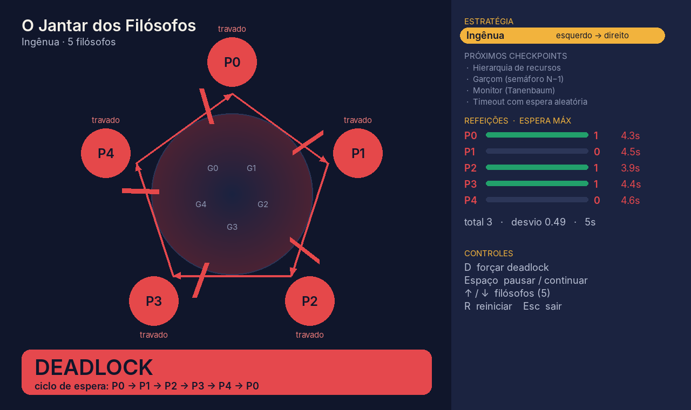

# O Jantar dos Filósofos

Simulação do problema clássico de sincronização com **threads reais**: cada filósofo é uma
thread, cada garfo é um `threading.Lock`, e a tela só desenha o que as threads estão fazendo.

Trabalho de **Sistemas Operacionais — Ciência da Computação, UFG**
**Grupo CJPY:** Carlos Alberto R. da S. Junior · Yan Di Nápoli Araújo · Pedro Crispim Pereira · João Vitor Justiniano



## Estado atual: Checkpoint 1 (prévia)

Primeira versão do código: a **solução ingênua** rodando com threads reais, com a possibilidade de
**forçar o deadlock** e ver o **ciclo de espera** detectado automaticamente. As soluções entram nos
próximos checkpoints (ver [Roteiro](#roteiro-por-checkpoint)).

## Como rodar

Requer Python 3.10 ou mais novo.

```bash
git clone https://github.com/yaandn/jantar-dos-filosofos.git
cd jantar-dos-filosofos
python -m venv .venv
source .venv/bin/activate        # Windows: .venv\Scripts\activate
pip install -e ".[dev]"

python -m jantar                 # abre a simulação
```

### Controles

| Tecla | Ação |
|---|---|
| `D` | **Forçar deadlock**: todos pegam o garfo esquerdo juntos |
| `Espaço` | Pausar / continuar |
| `↑` / `↓` | Número de filósofos (2 a 10) |
| `R` | Reiniciar |
| `Esc` | Sair |

Cores: **azul** pensando · **amarelo** com fome · **verde** comendo · **vermelho** travado ou
esperando há muito tempo. Quando há deadlock, a mesa fica vermelha e aparece o ciclo de espera.

Sem interface, no terminal:

```bash
python -m jantar --sem-interface --forcar-deadlock --tempo 8
```

## Como funciona

```
filosofo(i):
  loop:
    pensar()
    pegar(garfo[i])            # esquerdo  -> lock.acquire()
    pegar(garfo[(i+1) % N])    # direito   -> lock.acquire()
    comer()
    soltar(ambos)              # lock.release()
```

- `pegar` é **bloqueante**: a thread dorme até o garfo ser liberado.
- **Forçar deadlock**: os filósofos param de pensar, pegam o garfo esquerdo e se encontram numa
  barreira antes de tentar o direito. Assim todos seguram um garfo e esperam o do vizinho.
- **Detector de deadlock**: monta o grafo de espera (filósofo → dono do garfo que ele espera) e
  procura um ciclo. Se o mesmo ciclo aparece em duas leituras seguidas, é deadlock.
- **Métricas** no painel: refeições por filósofo e espera máxima (base para medir justiça e starvation).
- **GIL do Python**: não evita o problema. Ele é de lógica: o GIL troca de thread no meio da
  execução, então as threads disputam os locks e travam do mesmo jeito.

## Roteiro por checkpoint

| Checkpoint | Código |
|---|---|
| **1 (atual)** | Ingênua + forçar deadlock + detector + pausa + nº de filósofos |
| 2 | Hierarquia de recursos e garçom (quebram a espera circular) |
| 3 | Monitor de Tanenbaum e timeout (posse e espera / não preempção) + benchmark comparativo |
| Final | Comparação de métricas, relatório completo e demo |

## Testes

```bash
pytest -q
```

Verificam que a ingênua trava quando forçada, que vizinhos nunca comem juntos (exclusão mútua)
e que o detector acha o ciclo de espera. O GitHub Actions roda tudo a cada push.

## Estrutura

```
src/jantar/
  mesa.py           garfos (locks), filósofos, tempo, "forçar deadlock"
  simulacao.py      cria as threads, detector de deadlock, métricas
  estrategias/      uma estratégia por arquivo (checkpoint 1: ingênua)
  interface.py      visualização em Pygame (só lê o estado)
  benchmark.py      tabela de métricas por estratégia
  __main__.py       linha de comando
tests/              testes automatizados
docs/relatorio/     relatório técnico
docs/apresentacao/  slides e roteiros
```
