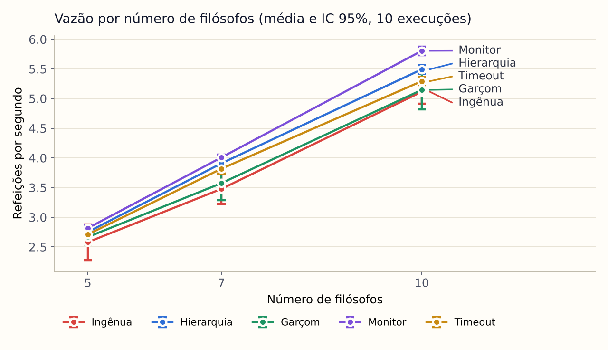
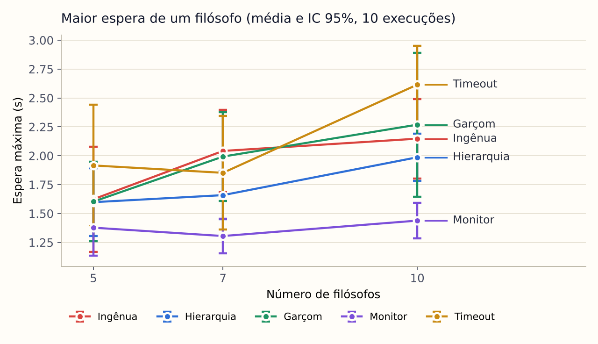

# O Jantar dos Filósofos: deadlock e sincronização com threads reais

**Grupo CJPY** — Carlos Alberto R. da S. Junior · Yan Di Nápoli Araújo · Pedro Crispim Pereira · João Vitor Justiniano\
Sistemas Operacionais · Ciência da Computação · Universidade Federal de Goiás · 2026/2

> **Resumo.** Implementamos o Jantar dos Filósofos com threads e locks reais em Python, reproduzimos o deadlock de forma controlada e o detectamos automaticamente pelo grafo de espera. Comparamos a solução ingênua com quatro soluções da literatura — hierarquia de recursos, garçom, monitor e timeout — em 315 execuções, variando o número de filósofos e o cenário (normal e pior caso forçado). A ingênua travou em **30 de 30** execuções no pior caso, enquanto as quatro soluções travaram em **0 de 120**, confirmando as condições de Coffman. O monitor obteve a maior vazão e a menor espera em todos os tamanhos de mesa; o garçom evitou o deadlock com a menor vazão entre as soluções; nenhuma estratégia apresentou inanição nas janelas medidas (índice de Jain ≥ 0,997).

## 1. Introdução

O Jantar dos Filósofos foi proposto por Dijkstra como exercício de sincronização e ganhou a forma atual com Hoare [2, 4]: *N* filósofos sentam-se em volta de uma mesa com *N* garfos, um entre cada par de pratos, e cada um alterna entre pensar e comer. Para comer, precisa dos **dois garfos vizinhos**. Em sistemas operacionais, o filósofo é um processo ou *thread*, o garfo é um recurso de uso exclusivo (um *mutex*) e comer é a **seção crítica** [7, 8].

O problema ilustra os riscos de proteger recursos com travas. No **deadlock**, todos ficam bloqueados esperando uns pelos outros; na **starvation**, o sistema progride mas um processo nunca é atendido; no **livelock**, os processos continuam ativos sem progredir [7, 8]. Coffman, Elphick e Shoshani [1] mostraram que o deadlock exige quatro condições simultâneas — **exclusão mútua, posse e espera, não preempção e espera circular** —, de modo que basta quebrar uma delas para preveni-lo.

A literatura propõe soluções que quebram condições diferentes. A **hierarquia de recursos** de Dijkstra [2] impõe uma ordem global aos garfos e elimina a espera circular. O **garçom**, um semáforo que admite no máximo *N* − 1 filósofos à mesa [3], também impede o ciclo. O **monitor** [5], na versão de Tanenbaum [8], faz cada filósofo pegar os dois garfos de uma vez ou dormir, quebrando a posse e espera. Soluções com **timeout** devolvem o recurso quando o segundo não está disponível, quebrando a não preempção [7]. Chandy e Misra [6] estendem o problema ao caso distribuído com garantia de justiça. Para medir justiça, usamos o índice de Jain, Chiu e Hawe [9].

Este trabalho reproduz esses resultados clássicos em um ambiente executável e os quantifica.

## 2. Objetivos

**Geral:** desenvolver uma simulação visual do Jantar dos Filósofos com threads reais para reproduzir o deadlock e comparar estratégias de sincronização.

| # | Objetivo específico | Métrica de avaliação |
|---|---|---|
| O1 | Reproduzir o deadlock de forma controlada | Execuções com deadlock no pior caso forçado |
| O2 | Detectar o ciclo de espera automaticamente | Deadlocks reais apontados pelo detector |
| O3 | Implementar quatro soluções da literatura | Soluções implementadas sem deadlock |
| O4 | Comparar as soluções | Vazão, justiça (Jain) e espera máxima |

## 3. Metodologia

### 3.1 Implementação

Cada filósofo é uma `threading.Thread` e cada garfo um `threading.Lock`; pegar um garfo é um `acquire` bloqueante. Uma *thread* separada monta o **grafo de espera** (filósofo → dono do garfo que ele espera) a cada 0,15 s e declara deadlock quando o mesmo ciclo aparece em duas leituras seguidas. Para criar o **pior caso** sob demanda, a função "forçar deadlock" interrompe o pensar de todos e reúne os filósofos numa barreira (`threading.Barrier`) depois do primeiro garfo e antes do segundo. A interface em Pygame apenas lê o estado das *threads*.

| Estratégia | Regra | Condição de Coffman quebrada |
|---|---|---|
| Ingênua (controle) | Esquerdo, depois direito | nenhuma |
| Hierarquia [2] | Sempre o garfo de menor número primeiro | espera circular |
| Garçom [3] | Semáforo admite no máximo *N* − 1 à mesa | espera circular |
| Monitor [5, 8] | Pega os dois de uma vez ou dorme numa variável de condição | posse e espera |
| Timeout [7] | Sem o 2º garfo, solta o 1º e espera um tempo aleatório | não preempção |

O código tem **65 testes automatizados** (`pytest`), executados a cada *push* no GitHub Actions: corretude de cada solução com 2 a 10 filósofos, inclusive no pior caso; exclusão mútua; propriedades de cada solução; o detector e o índice de Jain.

### 3.2 Desenho experimental

Três experimentos, cada execução num processo novo, com pensar ~ U(0,4; 1,2) s e comer ~ U(0,4; 0,9) s, acelerados 4× (tempos reportados em segundos de simulação):

| Experimento | Cenário | Fatores | Execuções |
|---|---|---|---|
| E1 — corretude | Pior caso forçado | 5 estratégias × *N* ∈ {5, 7, 10} × 10 repetições, 20 s cada | 150 |
| E2 — desempenho | Normal | 5 estratégias × *N* ∈ {5, 7, 10} × 10 repetições, 32 s cada | 150 |
| E3 — longa duração | Normal | 5 estratégias × *N* = 5 × 3 repetições, 120 s cada | 15 |

**Métricas por execução:** vazão (refeições por segundo), justiça (índice de Jain sobre as refeições por filósofo: 1 = divisão perfeita, 1/*N* = um só come), espera máxima e média de um filósofo com fome e ocorrência de deadlock. Reportamos média e intervalo de confiança de 95% (*t* de Student). Ambiente: Python 3, Linux, 2 núcleos, duas execuções em paralelo.

## 4. Resultados

### 4.1 Corretude (E1)

| Estratégia | *N* = 5 | *N* = 7 | *N* = 10 | Total |
|---|---|---|---|---|
| Ingênua | 10/10 | 10/10 | 10/10 | **30/30** |
| Hierarquia | 0/10 | 0/10 | 0/10 | **0/30** |
| Garçom | 0/10 | 0/10 | 0/10 | **0/30** |
| Monitor | 0/10 | 0/10 | 0/10 | **0/30** |
| Timeout | 0/10 | 0/10 | 0/10 | **0/30** |

*Tabela 1 — Execuções com deadlock no pior caso forçado.*

A ingênua travou em todas as execuções forçadas, em média 3,5 s após o início da execução, e o detector apontou o ciclo de espera em todas elas (os testes automatizados verificam que o ciclo passa pelos *N* filósofos). As quatro soluções não travaram nenhuma vez, com qualquer tamanho de mesa. Sem forçar, a ingênua **não travou em nenhuma das 33 execuções normais** (E2 e E3): o deadlock depende de uma intercalação específica das *threads* e é raro no uso comum.

### 4.2 Desempenho (E2)



*Figura 1 — Vazão por número de filósofos (média e IC 95%, 10 execuções por ponto).*

| Estratégia | Vazão *N* = 5 | Vazão *N* = 10 | Jain (*N* = 10) | Espera média (*N* = 10) | Espera máx. (*N* = 10) |
|---|---|---|---|---|---|
| Ingênua | 2,58 ± 0,30 | 5,12 ± 0,20 | 0,999 | 0,49 ± 0,08 s | 2,15 ± 0,34 s |
| Hierarquia | 2,75 ± 0,05 | 5,49 ± 0,07 | 0,997 | 0,35 ± 0,02 s | 1,99 ± 0,20 s |
| Garçom | 2,67 ± 0,13 | 5,15 ± 0,33 | 0,999 | 0,48 ± 0,13 s | 2,27 ± 0,62 s |
| **Monitor** | **2,82 ± 0,05** | **5,81 ± 0,07** | 0,999 | **0,26 ± 0,01 s** | **1,44 ± 0,15 s** |
| Timeout | 2,71 ± 0,06 | 5,29 ± 0,07 | 0,997 | 0,42 ± 0,03 s | 2,62 ± 0,34 s |

*Tabela 2 — Desempenho no cenário normal (média ± IC 95%; vazão em refeições/s). Tabelas completas em [`docs/resultados/final/tabelas.md`](docs/resultados/final/tabelas.md).*



*Figura 2 — Maior espera de um filósofo com fome (média e IC 95%).*

A vazão cresce quase linearmente com *N* em todas as estratégias. O **monitor** lidera em todos os tamanhos, seguido da hierarquia e do timeout; com *N* = 10 a diferença entre eles não se sobrepõe nos intervalos de confiança. O **garçom** fica próximo da ingênua e com a maior variabilidade entre as soluções. O monitor também tem a **menor espera** média e máxima; o timeout, a **maior espera máxima** com *N* = 10, efeito das tentativas frustradas seguidas de espera aleatória.

### 4.3 Longa duração (E3)

Em 120 s de simulação com 5 filósofos, o índice de Jain foi **1,000** em todas as estratégias, o filósofo que menos comeu fez ao menos 45 refeições (média por filósofo entre 59 e 68) e a pior espera não passou de 3,5 s. **Não houve inanição nem deadlock espontâneo.**

## 5. Discussão

### 5.1 Alcance dos objetivos

| Objetivo | Resultado | Alcance |
|---|---|---|
| O1 — Reproduzir o deadlock | 30/30 execuções forçadas travaram, com 5, 7 e 10 filósofos | Atingido |
| O2 — Detectar o ciclo | Ciclo completo apontado nos 30 travamentos; nenhum alarme falso em 285 execuções | Atingido |
| O3 — Implementar 4 soluções | 4 soluções implementadas, 0/120 deadlocks | Atingido |
| O4 — Comparar as soluções | Vazão, justiça e espera medidas em 315 execuções, com IC 95% | Atingido |

### 5.2 Comparação com a literatura

| Referência | O que a literatura afirma | O que observamos |
|---|---|---|
| Coffman et al. [1] | Deadlock exige as quatro condições; quebrar uma basta | Ingênua (4 condições) 30/30; soluções (uma quebrada cada) 0/120 — **confirmado** |
| Dijkstra [2] | A ordem global dos recursos elimina a espera circular | Hierarquia 0/30, segunda maior vazão — **confirmado** |
| Downey [3] | O garçom (*N* − 1 à mesa) evita o deadlock limitando a concorrência | Garçom 0/30, mas a menor vazão entre as soluções — **confirmado, com custo** |
| Hoare [5]; Tanenbaum [8] | O monitor evita deadlock permitindo o paralelismo máximo | Maior vazão e menor espera em todos os *N* — **confirmado** |
| Silberschatz et al. [7] | Liberar recursos retidos (preempção) previne o deadlock, ao custo de retrabalho | Timeout 0/30, com tentativas repetidas e maior espera máxima — **confirmado** |
| Silberschatz [7]; Tanenbaum [8] | Deadlock é raro na prática; muitos sistemas o ignoram | Ingênua: 0/33 sem forçar × 30/30 forçada — **confirmado** |
| Chandy e Misra [6]; Jain et al. [9] | Evitar deadlock não garante justiça; garantia exige protocolo específico | Jain ≥ 0,997 sem protocolo de justiça — **inanição não observada**, o que não prova sua ausência |

Os resultados reproduzem as previsões clássicas: cada solução elimina o deadlock exatamente pela condição de Coffman que quebra, e o custo aparece onde a literatura indica — concorrência limitada no garçom, retrabalho no timeout. A ausência de inanição não contradiz a teoria: as soluções não a **garantem**, mas os tempos aleatórios tornam improváveis as intercalações adversas que a provocam.

**Limitações.** O pior caso é induzido por uma barreira artificial; os tempos de pensar e comer são esperas sintéticas; o GIL do Python impede medir desempenho bruto de CPU, de modo que comparamos corretude, justiça e espera; e 10 repetições por ponto bastam para as diferenças grandes, mas não para as pequenas (por exemplo, garçom × ingênua).

## 6. Conclusão

Os quatro objetivos foram atingidos. O projeto reproduziu de forma controlada um deadlock que, sem intervenção, não apareceu em nenhuma das 33 execuções normais, e o detectou automaticamente pelo ciclo no grafo de espera. As quatro soluções eliminaram o deadlock em 120 execuções no pior caso, confirmando que basta quebrar uma condição de Coffman. Entre elas, o **monitor** teve o melhor desempenho e a menor espera, a **hierarquia** foi a mais simples com resultado próximo, o **timeout** pagou com espera nas tentativas e o **garçom** com concorrência. Como trabalhos futuros, ficam a solução de Chandy e Misra, a demonstração de livelock com espera fixa e a medição de inanição sob escalonamento adverso.


## 7. Como executar

```bash
git clone https://github.com/yaandn/jantar-dos-filosofos.git && cd jantar-dos-filosofos
python -m venv .venv && source .venv/bin/activate     # Windows: .venv\Scripts\activate
pip install -e ".[dev]"
python -m jantar                      # interface: teclas 1–5 estratégia, D força deadlock, Espaço pausa, ↑/↓ filósofos
pytest -q                             # 65 testes
python -m jantar.experimentos         # bateria completa (315 execuções) → docs/resultados/final/
python -m jantar.analise              # tabelas e gráficos do relatório
```

## Referências


[1] COFFMAN, E. G.; ELPHICK, M. J.; SHOSHANI, A. System deadlocks. *ACM Computing Surveys*, v. 3, n. 2, p. 67–78, 1971.

[2] DIJKSTRA, E. W. Hierarchical ordering of sequential processes. *Acta Informatica*, v. 1, n. 2, p. 115–138, 1971.

[3] DOWNEY, A. B. *The Little Book of Semaphores*. 2. ed. Green Tea Press, 2016.

[4] HOARE, C. A. R. *Communicating Sequential Processes*. Englewood Cliffs: Prentice Hall, 1985.

[5] HOARE, C. A. R. Monitors: an operating system structuring concept. *Communications of the ACM*, v. 17, n. 10, p. 549–557, 1974.

[6] CHANDY, K. M.; MISRA, J. The drinking philosophers problem. *ACM TOPLAS*, v. 6, n. 4, p. 632–646, 1984.

[7] SILBERSCHATZ, A.; GALVIN, P. B.; GAGNE, G. *Fundamentos de sistemas operacionais*. 9. ed. Rio de Janeiro: LTC, 2015.

[8] TANENBAUM, A. S.; BOS, H. *Sistemas operacionais modernos*. 4. ed. São Paulo: Pearson, 2016.

[9] JAIN, R.; CHIU, D.-M.; HAWE, W. R. *A quantitative measure of fairness and discrimination for resource allocation in shared computer systems*. DEC Research Report TR-301, 1984.
